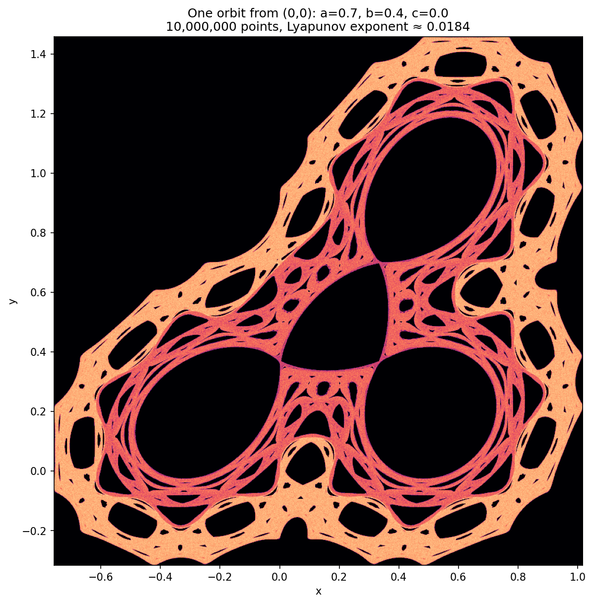
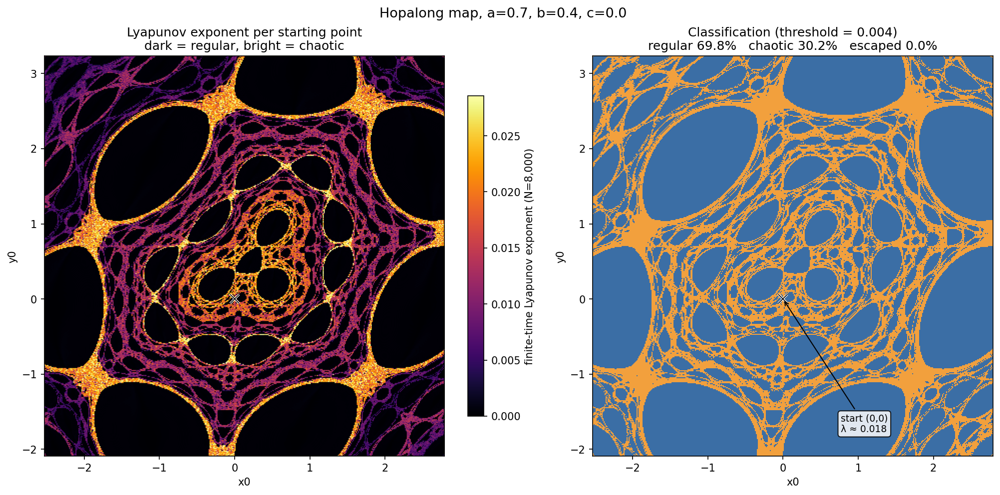
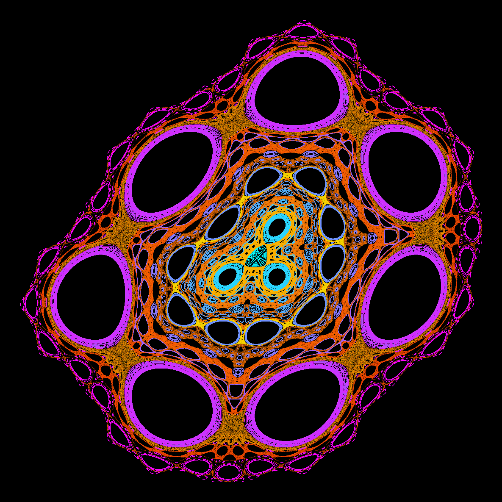

# Hopalong map: regular and chaotic regions

`hopalong_phase_space.py` explores the phase space of the Hopalong map (Barry Martin [2]) with three views of the same map:

- **orbit:** one orbit from (0,0) as a density image, the classic Hopalong picture
- **map:** a Lyapunov exponent for every starting point on a grid, classifying each as regular or chaotic
- **portrait:** many orbits on a dark background, coloured by that classification (meant for looking at, not for measuring)

A fourth option, **header**, renders a wide version of the portrait for use as a blog header.

The script runs in two passes. A fast first pass finds the extents (scale, centre, orbit box), and the second pass draws the views with them, so the framing follows `a`, `b`, `c` and the number of points without manual tuning.







## Scope

The Hopalong map is due to Barry Martin [2]. In German it appeared as the program HÜPFER in A.K. Dewdney's computer column in *Spektrum der Wissenschaft* [3]. It is often called an "attractor", but it preserves area, and mixed regular and chaotic motion is the standard behaviour of area-preserving maps. Nothing here is a new result. The script checks that behaviour numerically, mainly for one parameter set (`a=0.7`, `b=0.4`, `c=0`), and gives a way to see it. The references give the sources of the map; the results here have not been compared with them or with other literature on the dynamics of the map.

## The map

For parameters `a`, `b`, `c`:

$$
x_{n+1}=y_n-\mathrm{sign}(x_n)\sqrt{\left|bx_n-c\right|}

y_{n+1}=a-x_n
$$

Where it is differentiable, its Jacobian is

$$
J(x)=\begin{pmatrix}
-\frac{b\cdot\mathrm{sign}(x)\cdot\mathrm{sign}(bx-c)}{2\sqrt{\left|bx-c\right|}}&1\\
-1&0
\end{pmatrix}
$$

with determinant

$$
\det J=1
$$

The map is also invertible, because `x_n=a-y_{n+1}` gives `x_n` and then `y_n` follows from the first equation. Together this means it preserves area, so nothing contracts onto an attracting set and the picture depends on where an orbit starts.

### Scaling and fixed point

The map keeps its form under

$$
(x,y,a,b,c)\to(sx,sy,sa,sb,s^2c)
$$

so `a` and `b` behave like lengths and `c` like a length squared. Orbits scale with the length scale `L=max(|a|,|b|,sqrt|c|)`, and the Lyapunov exponent does not change at all. This is what lets the framing scale exactly with the parameters.

The fixed points (`y=a-x`) solve

$$
2x-a+\mathrm{sign}(x)\sqrt{\left|bx-c\right|}=0
$$

Because `det J=1`, a fixed point is elliptic (the centre of an island) when the upper-left entry of `J` there has absolute value below 2, and hyperbolic otherwise.

## The Lyapunov exponent

A tangent vector is pushed forward along the orbit and renormalised at every step:

$$
v_n=J(x_{n-1})\hat v_{n-1}
$$

$$
\hat v_n=\frac{v_n}{\lVert v_n\rVert}
$$

The largest finite-time exponent over N steps is the mean logarithmic stretching:

$$
\lambda_N=\frac{1}{N}\sum_{n=1}^{N}\ln\lVert v_n\rVert
$$

For a regular (quasi-periodic) orbit the stretching is typically only linear in n, so λ falls toward 0, roughly like

$$
\lambda_N\sim\frac{\ln N}{N}
$$

and finite-time noise can push it slightly below zero. For a chaotic orbit the stretching is exponential and λ stays clearly positive. The first 500 steps are discarded so the tangent vector can align.

## Usage

```bash
pip install numpy matplotlib numba
python hopalong_phase_space.py --save                  # orbit, map and portrait as PNG
python hopalong_phase_space.py --which header --save   # 1600 x 900 header image
python hopalong_phase_space.py --a 1.1 --b 0.5 --c 0.3 --iters 2000000
python hopalong_phase_space.py --a 2 --b 1 --survey-only   # pass 1 only: print the extents
```

Without `--save` the figures open in windows. The default run of all three views took about 35 s on a single core here, including compilation. The map is the slow part and runs in parallel across cores. The main options:

- `--a`, `--b`, `--c`: map parameters (default 0.7, 0.4, 0)
- `--which`: `all` (orbit, map, portrait), `orbit`, `map`, `portrait` or `header`
- `--survey-only`: run pass 1 only and print the extents
- `--iters`: points of the single orbit from (0,0) (default 10,000,000)
- `--bins`: density image pixels on the longer side (default: from `--iters`)
- `--lyap-iters`, `--grid`: iterations per orbit and grid points per axis for the map (default 8000 and 400)
- `--thresh`: exponent above which an orbit counts as chaotic (default 0.004)
- `--window-scale`: map window half-size in units of `L` (default 3.8)
- `--xlim`, `--ylim`, `--start`, `--end`: override the automatic window and portrait line
- `--portrait-orbits`, `--portrait-iters`: number of orbits and points per orbit
- `--header-size`, `--header-zoom`: header pixels (default 1600 900) and crop (default 1.4)
- `--outdir`: folder for the PNG files

## How the framing works

**Pass 1 (survey)** takes about half a second for the default run and finds:

- the length scale `L`
- the centre of the structure: the fixed point nearest the origin, elliptic if there is one, otherwise hyperbolic, otherwise the centre of the orbit box
- the exact bounding box of the orbit from (0,0) over all `--iters` points, computed without storing the orbit
- the map window: the centre plus or minus `--window-scale` times `L`
- the portrait line: from the centre towards the upper right, ending at 0.9 times the window half-size
- the size of the density image, from the number of points

**Pass 2 (render)** fills the density image while the orbit runs, so memory use does not depend on `--iters`, then computes the map, portrait and header with those extents. The portrait and header are cropped to exactly what was drawn.

The factor 3.8 was chosen so that the default parameters show the central structure and the first ring of islands. It is a zoom choice, not a property of the map (see the caveats).

## How to read the figures

**Orbit:** brightness is the log of how often the orbit visited each pixel. Black regions were never visited by this orbit.

**Map**

- Left panel: colour is the finite-time exponent of the orbit that starts at that point. Dark means about 0, so regular. Bright means chaotic.
- Right panel: the same data split at the threshold. Blue is regular, orange is chaotic, grey would mean the orbit escaped.
- Large dark or blue blobs are islands of regular motion. The cross marks (0,0).

**Portrait**

- Each colour is one orbit. Cool colours (cyan to magenta) are regular orbits and only encode the position of the starting point along the line, so they carry no measured value. Warm colours (yellow to red) are chaotic orbits, brighter for a larger exponent.
- Nested rings are regular orbits circling an island. Dense warm bands are chaotic orbits filling the space between islands.
- The starting line is a fixed choice (from the centre towards the upper right). Islands it does not cross, or only grazes, stay empty.

## What the run shows

Results for the default settings (`a=0.7`, `b=0.4`, `c=0`, 400 x 400 grid, N=8000, threshold 0.004), in the default window x from -2.45 to 2.87 and y from -2.17 to 3.15:

1. 69.8% of starting points are regular and 30.2% are chaotic. None escaped.
2. The orbit from (0,0) has λ ≈ 0.018 (10 million iterations; 30 million gave 0.0182 and 300 million gave 0.0179, while a 2 million run gave 0.0199, so single-orbit estimates vary by about 10%). The classic picture is therefore the footprint of one chaotic orbit. The regions it leaves empty are regular islands it does not enter.
3. The extent of that orbit depends on how long it runs. It was the same box (x from -0.76 to 1.02, y from -0.32 to 1.46) for 2 million to 100 million points. Between 100 and 300 million points it grew to x from -1.38 to 1.92 and y from -1.22 to 2.08, and stayed there up to one billion points. This is one run, and the exact point at which the orbit leaks out depends on floating-point details.
4. Starting points far away, such as (50,50), (-200,30) and (1000,-1000), gave λ below 3e-4, which is regular. The chaotic share is 31.3% for a window twice the default size and 20.0% for four times, so the percentage depends on the window.
5. Exponents inside the chaotic region vary, from about 0.01 to about 0.03 in the figure. The script does not explain why.
6. The chaotic share is 30-31% for N from 4000 to 20000 and thresholds from 0.002 to 0.004. At a threshold of 0.008 it falls to about 25-27%.

**Scaling test.** Scaling the parameters by the symmetry above gives the same picture at a different size. For `a=0.7`, `b=0.4`, `c=0` scaled by 10 and by 0.01, for `a=1.1`, `b=0.5`, `c=0.3` scaled by 3 and by 0.2, and for `a=2`, `b=1`, `c=0` scaled by 7, the window width scaled by exactly the factor, the centre and portrait line scaled with it, and the chaotic share on a 120 x 120 grid was identical.

**Memory and speed.** In one test, 300 million points took about 11 s in total (3.5 s for pass 1) with a peak memory of about 200 MB. The histogram that is filled while the orbit runs matches `np.histogram2d` on the stored orbit: in a test with 1 million points, all 89,700 cells were identical. A version that feeds chunks of the orbit to `np.histogram2d` also keeps memory constant and gave identical counts for 20 and 100 million points, but took about five times as long (16.5 s against 3.0 s for 100 million points).

Visible in the portrait but not tested: a ring of seven large islands around the centre, whose interiors stay empty because the starting line only grazes their rims, and an inner ring of about ten smaller islands.

## Caveats

- The structure has no outer edge to detect. In a coarse survey with thresholds of 0.004 and 0.008, chaotic orbits were still found at every probe size tried (up to 64 units from the origin). The window is therefore a zoom choice around the fixed point, and `--window-scale` changes it.
- Only one parameter set was studied in detail. The automatic framing was checked by eye on six parameter sets (including a hyperbolic centre and a window of about 400 units across), but their pictures were not analysed, and nothing here says how the picture changes with `a`, `b`, `c`.
- The percentages depend on the window and describe the plotted region, not the whole plane.
- The extent of the orbit from (0,0) depends on `--iters` (see item 3), so the density image is framed on the full run. A very long run can show a much larger region than a short one.
- The exponent is finite-time. Chaotic orbits that stick near islands can look regular over N steps, so the chaotic share can be under-counted near island boundaries.
- Islands smaller than the grid spacing (about 0.013 at the defaults) are not resolved.
- The square-root term has an unbounded derivative at `bx=c`. A floor of 1e-12 on the square root keeps the code finite, and smooth-map theory such as KAM is only an analogy here.
- Orbits are computed in floating point. Exponents and fractions were checked only by varying N, threshold and window.

## References

[1] **J. Lansdown and R. A. Earnshaw (eds.)**, *Computers in Art, Design and Animation*. New York: Springer-Verlag, 1989.

[2] **Barry Martin**, "Graphic Potential of Recursive Functions," in *Computers in Art, Design and Animation* [1], pp. 109–129.

[3] **A.K. Dewdney**, *Psychotapeten*, algorithm *HÜPFER*, in *Spektrum der Wissenschaft: Computer Kurzweil*. Heidelberg: Spektrum der Wissenschaft Verlagsgesellschaft mbH & Co., 1988. (German edition of *Scientific American*.)
