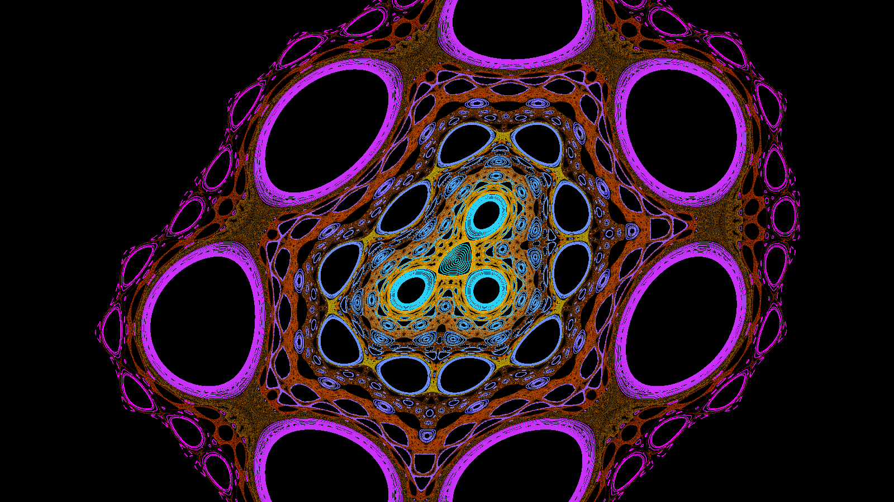
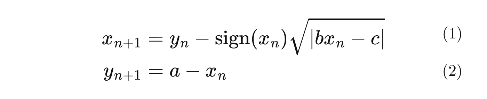
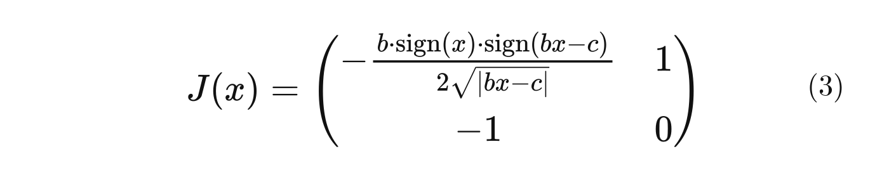
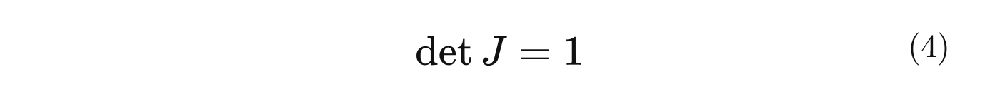
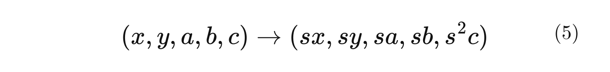
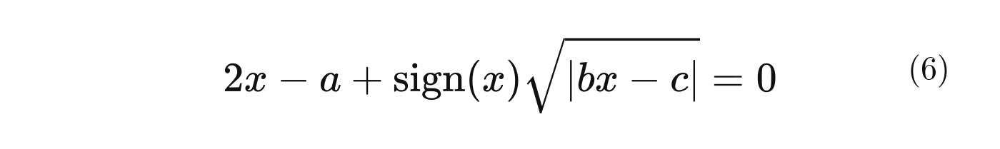
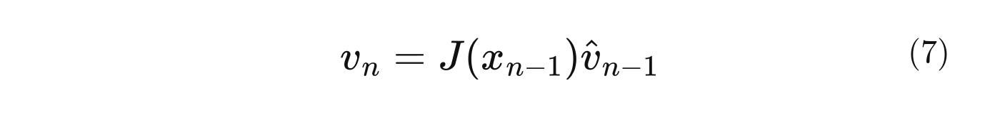
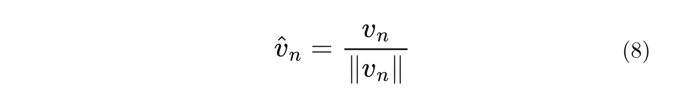
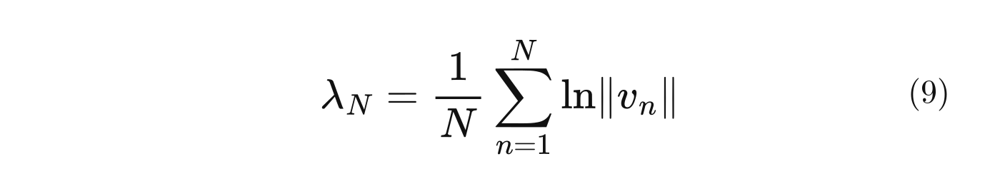

# The Hopalong "Attractor" That Isn't One

## A classic computer-art map has no attractor. Here is how to see its regular and chaotic regions with a few lines of Python and numba



*Orbits of the Hopalong map. Cool colours are regular orbits circling islands, warm colours are chaotic orbits.*

Search for "Hopalong attractor" and you get glowing, symmetric pictures made from nothing but two lines of arithmetic. They are fun to produce and easy to share. But the word "attractor" hides what the picture actually is.

This article walks through what the Hopalong map does, why the name is misleading, and how to see all of its phase space at once instead of one orbit at a time. None of this is new to dynamical-systems people. The point is that a short numba script makes it easy to see for yourself.

## The map

Barry Martin's Hopalong map [2] turns each point of an orbit into the next one, using three parameters a, b and c:



Start at (0,0), repeat millions of times, plot every point. With a = 0.7, b = 0.4 and c = 0 you get a picture like the one below. (In German the map appeared as the program HÜPFER in A.K. Dewdney's column in *Spektrum der Wissenschaft* [3].)

## One orbit, one picture

The core loop is short. With numba it compiles to machine code and runs ten million iterations in about a second:

```python
import numpy as np
from numba import njit

@njit
def orbit(a, b, c, n):
    xs, ys = np.empty(n), np.empty(n)
    x, y = 0.0, 0.0
    for i in range(n):
        x, y = y - np.sign(x) * np.sqrt(abs(b * x - c)), a - x
        xs[i], ys[i] = x, y
    return xs, ys
```

(This is a simplified version of the script's loop, which also discards a short transient and stops if an orbit escapes to infinity.)

A scatter plot of ten million points is slow and saturates into a solid blob. A log-scaled 2D histogram is faster and shows structure:


Notice the black regions. The orbit never enters them, and they are the first hint that something is going on.

The picture also depends on how long you run the orbit. In one run it stayed inside the same box from 2 million up to 100 million points, then leaked into a larger region somewhere between 100 and 300 million points, and the box grew from about x −0.76 to 1.02 to about x −1.38 to 1.92. The exact point at which this happens depends on floating-point details, so treat it as an observation, not a constant. The script measures the extent over the full run so the image is framed correctly either way.

For long runs the script fills the 2D histogram while the orbit runs instead of storing the points, which keeps memory constant (in one test, 300 million points took about 11 seconds and about 200 MB) and gave counts identical to NumPy's `histogram2d` in the checks.

## Why it is not an attractor

An attractor is a set that nearby starting points are pulled toward. That requires the dynamics to shrink areas in phase space. The Hopalong map does not. Wherever it is differentiable, its Jacobian is



and its determinant is



The map is also invertible: equation (2) gives the old x from the new y, and then equation (1) gives the old y. A map that is invertible and has determinant 1 preserves area. Nothing contracts, so there is nothing to attract.

What you see in the classic picture is the footprint of one orbit, and a different starting point can give a different picture. The name is a loose label, and it is common to call any shape drawn by an iterated map an attractor. It is fine to keep using it, as long as you know what the image is.

Two more facts about the map will matter later. It keeps its form under the scaling



for any scale factor s, so a and b behave like lengths and c like a length squared. And its fixed points satisfy



with y = a − x.

## Seeing all of phase space

If one orbit only tells part of the story, we want a way to classify every starting point. The standard tool is the Lyapunov exponent: how fast two nearby orbits separate.

- A **regular** orbit stays on a closed curve or a chain of islands. Nearby orbits separate slowly and the exponent is about zero.
- A **chaotic** orbit fills an area. Nearby orbits separate exponentially and the exponent is positive.

To estimate it, a tangent vector is pushed forward by the Jacobian (3) and renormalised at every step; the hat marks a vector rescaled to length 1:





The largest finite-time exponent over N steps is the mean logarithmic stretching:



In code, it is the same loop with a few extra lines:

```python
@njit
def lyapunov(a, b, c, x, y, n):
    vx, vy = 1.0, 0.0
    total = 0.0
    for i in range(n):
        d = b * x - c
        r = max(np.sqrt(abs(d)), 1e-12)       # guard the sqrt singularity
        dfdx = -np.sign(x) * b * np.sign(d) / (2.0 * r)
        x, y = y - np.sign(x) * np.sqrt(abs(d)), a - x
        vx, vy = dfdx * vx + vy, -vx
        norm = np.sqrt(vx * vx + vy * vy)
        vx, vy = vx / norm, vy / norm
        total += np.log(norm)
    return total / n
```

(Also simplified: the script additionally discards the first 500 steps so the tangent vector can align, and stops if the orbit escapes.)

Run it over a 400 × 400 grid of starting points (numba's `prange` spreads the grid over your cores) and colour each point by its exponent:


In the plotted window (x from −2.5 to 2.9, y from −2.2 to 3.2), about 70% of the starting points are regular and about 30% are chaotic, with 8,000 iterations per point. The dark blobs are islands of regular motion, and the bright bands between them are the chaotic region. The cross marks (0,0). Its orbit has an exponent of about 0.018 and lies in the chaotic region, which is why the classic picture has those empty holes: it is one chaotic orbit, and most of the empty holes are regular islands it does not enter (in a pixel-by-pixel check, about 81% of the empty pixels start regular orbits).

Starting points far from the centre, such as (50,50) or (1000,−1000), turned out to be regular, but a coarse survey still found chaotic orbits at every distance we probed (up to 64 units from the origin), so the structure has no sharp outer edge.

## A prettier version

The classification map is informative but pixelated. For a more attractive picture, start a few hundred orbits along a line through phase space and draw each one as its own set of points. Regular orbits become nested rings around the islands, and chaotic ones fill the bands in between:


The warm colours (yellow to red) are chaotic orbits, brighter for a larger exponent. The cool colours (cyan to magenta) are regular orbits, but there they only encode the position of the starting point along the line, so they are decoration, not data.

The picture shows a ring of seven large islands around the centre and an inner ring of about ten smaller ones. The line of starting points only grazes the rims of the large islands, so their interiors stay empty. We did not analyse these island chains further.

## What this is, and what it isn't

Mixed regular and chaotic motion is the standard behaviour of area-preserving maps, and this article reproduces it for one parameter set. The references at the end give the sources of the map; the results here have not been compared with them or with other literature on its dynamics. A few limits are worth knowing:

- **The percentages depend on the window.** The chaotic share is about 31% in a window twice as wide as the one above, but about 20% at four times as wide. The numbers describe the plotted region, not the whole plane.
- **The threshold matters a little.** The chaotic share stays at 30–31% for thresholds from 0.002 to 0.004 and for 4,000 to 20,000 iterations. At a threshold of 0.008 it drops to about 25–27%, because weakly chaotic orbits are no longer counted.
- **The exponent is finite-time.** Orbits that stick near an island can look regular over a short run, so the chaotic share can be under-counted near island boundaries. Even the exponent of the orbit from (0,0) varies by about 10% between runs of different length.
- **The square-root term is singular at b·x = c.** The derivative is unbounded there, so classical results for smooth maps are an analogy, not a guarantee.
- **One parameter set.** Nothing here says how the picture changes as a, b and c vary.

## Try it yourself

The full script produces all three views and the header image, with a, b, c and the iteration counts as command-line options:

```txt
pip install numpy matplotlib numba
python hopalong_phase_space.py --save
python hopalong_phase_space.py --a 1.1 --b 0.5 --c 0.3 --iters 2000000
```

The script runs in two passes. A quick first pass finds the length scale of the map from a, b and c, the centre of its structure (the map's fixed point) and the exact extent of the orbit from (0,0). The second pass draws the three views with that framing, so you can change a, b, c and the number of points and still get a framed picture. How much of the structure fits the window depends on the parameters, though: the window is 3.8 length scales around the fixed point (or around the middle of the orbit if there is none), which is a zoom choice, and for maps with much larger orbits you will want `--window-scale`.

Code and README: [GitHub repository](https://github.com/ratwolfzero/hopalong_phase_space)

A pretty picture is a good way into a real question. Here the question is how a map that preserves area still produces such rich structure, and the answer is that its phase space is not one thing but a patchwork of regular and chaotic regions. The natural next step is to ask how that patchwork changes as the parameters move.

## References

[1] **J. Lansdown and R. A. Earnshaw (eds.)**, *Computers in Art, Design and Animation*. New York: Springer-Verlag, 1989.

[2] **Barry Martin**, "Graphic Potential of Recursive Functions," in *Computers in Art, Design and Animation* [1], pp. 109–129.

[3] **A.K. Dewdney**, *Psychotapeten*, algorithm *HÜPFER*, in *Spektrum der Wissenschaft: Computer Kurzweil*. Heidelberg: Spektrum der Wissenschaft Verlagsgesellschaft mbH & Co., 1988. (German edition of *Scientific American*.)
